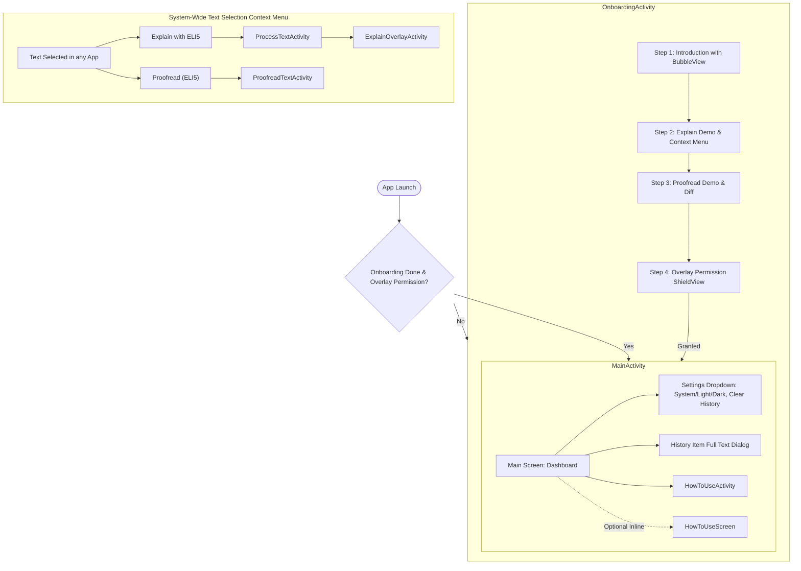

# ELI5 Android Application Reconstruction Notes

## 1. Application Architecture

- **Package Name**: `com.alaotach.eli5`
- **Application Type**: Hybrid Modern Android Application (Jetpack Compose Material3 for Dashboard & Info, custom programmatic Views/Activities with translucent windows for system-wide Text Processing Overlays, ViewPager2/Fragments for Onboarding).
- **Architecture Pattern**: MVVM with Kotlin Coroutines & Flows, SharedPreferences-based lightweight persistence.
- **Min SDK**: 24 (Android 7.0)
- **Target SDK**: 36 (Android 16)
- **Compile SDK**: 36
- **Build Tools / AGP**: Android Gradle Plugin 8.13.2 / Kotlin 2.0.21 / Compose BOM 2024.09.00 / Material3 1.3.0.

### UI Architecture
1. **MainActivity**: Edge-to-Edge Compose Activity (`ComponentActivity`) hosting `Eli5Theme`. Displays `MainScreen` (recent activity, stats, how-to launch, theme settings dropdown) or `HowToUseScreen`.
2. **OnboardingActivity**: Onboarding flow with `ViewPager2` host running 4 fragments (`Step1Fragment`, `Step2Fragment`, `Step3Fragment`, `Step4Fragment`) with custom interactive canvas views (`BubbleView`, `DotsIndicatorView`, `ShieldView`) and overlay permission launcher.
3. **HowToUseActivity**: Standalone visual tutorial with animated `ViewFlipper`, step mockups, interactive transitions, and `DotsView`.
4. **ProcessTextActivity**: Invisible translucent trampoline activity (`android.intent.action.PROCESS_TEXT`) with priority 99999. Routes text selection directly to `ExplainOverlayActivity` (or handles clipboard copy if `copy_text` is passed).
5. **ExplainOverlayActivity**: System overlay bottom sheet dialog (`BottomSheetDialog`) displaying streamed AI explanations in real-time with Markdown formatting (using Markwon 4.6.2), interactive mode tabs (`ELI5`, `Direct`, `Detailed`), and copy/dismiss controls.
6. **ProofreadTextActivity**: System overlay floating window (`Theme.Translucent.NoTitleBar`) for interactive proofreading and rewriting with word-level LCS visual diffs (green additions, red strikethrough deletions), custom instructions input prompt, and text replacement.

---

## 2. Screen and Navigation Map



---

## 3. Feature Inventory

1. **System Text Selection Integration (`PROCESS_TEXT`)**:
   - `Explain with ELI5`: Immediately pops up a native bottom sheet over whichever app the user is using (browser, WhatsApp, notes, Twitter, PDF viewer).
   - `Proofread (ELI5)`: Pops up floating proofread window to refine, tone-shift, fix errors, or adjust text with custom prompt instructions.
2. **Real-time Streaming AI Completions**:
   - Streams SSE response token-by-token directly into Markwon Markdown view or diff preview.
   - Includes typewriter effect with dynamic speed scaling to smooth chunk deliveries.
3. **Diff Highlighting Engine (`generateDiffSpannable`)**:
   - Word-level Longest Common Subsequence (LCS) algorithm.
   - Highlights added text in green (`#DAFBE1` light, `#284B30` dark).
   - Highlights removed text in red with strikethrough (`#FFEBE9` light, `#4A292D` dark).
   - Truncates preview beyond 200 words with clickable "... (Read full text)" button.
4. **History Management (`HistoryManager`)**:
   - Stores timestamp, originalText, resultText, mode as JSON in `eli5_history` SharedPreferences.
   - Fast, reliable, no Room database migration hurdles.
   - Supports listing, sorting descending, deleting individual items, and clearing all.
5. **Theme Preference Management (`SettingsManager`)**:
   - Persistent theme storage ("system", "light", "dark") in `eli5_settings`.
   - Dynamic dark mode calculation respecting system night mode.
6. **Interactive Onboarding & Tutorial**:
   - 4-step onboarding with custom Canvas-drawn graphics.
   - 4-step interactive tutorial (`HowToUseActivity`) simulating Android text selection popups and bottom sheets.

---

## 4. API Integration Map

### Base URL & Chat Completion Endpoint
- **Base URL**: `https://ai.hackclub.com/proxy/v1`
- **Endpoint**: `/chat/completions`
- **HTTP Method**: `POST`
- **Headers**:
  - `Content-Type`: `application/json`
  - `Authorization`: `Bearer <API_KEY>` (recovered key configured securely in `BuildConfig.API_KEY` with fallback)
- **Model**: `google/gemini-3-flash-preview`
- **Streaming**: `true` (Server-Sent Events `text/event-stream`)

### Explain Prompts:
- **ELI5**: `"Explain this like I am 5 years old. Use simple words and fun analogies."`
- **Straightforward / Direct**: `"Give a direct, clear, no-fluff summary of this."`
- **Detailed**: `"Give a very detailed, thorough analysis with deep context about this."`
- **Default/Casual**: `"Explain this casually."`
- **Payload Construction**:
  ```kotlin
  val prompt = "$instruction\n\nText to explain:\n$text\n\nExplanation:"
  ```

### Proofread Prompts:
- **Default (no custom instructions)**:
  `"Proofread and correct the following text. Do not use any em dashes (—). Keep the tone natural and human-like. Just provide the corrected text without any preamble or explanation:\n\n" + baseText`
- **With custom instructions**:
  `"Modify the following text based strictly on this instruction: \"" + customInstructions + "\". Do not use any em dashes (—). Keep the tone natural and human-like. Just provide the corrected text without any preamble or explanation:\n\n" + baseText`

### Streaming Response Parsing:
- Lines beginning with `data: ` are read.
- `[DONE]` signals stream completion.
- Delta extraction: `choices[0].delta.content`.

---

## 5. Data Models

```kotlin
data class HistoryItem(
    val timestamp: Long,
    val originalText: String,
    val resultText: String,
    val mode: String
)

enum class TextAction {
    EXPLAIN,
    SIMPLIFY,
    SUMMARIZE,
    TRANSLATE,
    KEY_POINTS
}

sealed class ProcessingState {
    object Idle : ProcessingState()
    object Loading : ProcessingState()
    data class Success(val result: String) : ProcessingState()
    data class Error(val message: String) : ProcessingState()
}
```

---

## 6. Permissions and Android Components

### Manifest Permissions
- `android.permission.SYSTEM_ALERT_WINDOW`: Display overlay windows on top of other applications.
- `android.permission.VIBRATE`: Haptic feedback on bottom sheet open.
- `android.permission.INTERNET`: Network access for AI proxy.

### Declared Activities
1. `com.alaotach.eli5.MainActivity` (MAIN, LAUNCHER, theme `@style/Theme.Eli5`, exported true)
2. `com.alaotach.eli5.HowToUseActivity` (theme `@style/Theme.AppCompat.NoActionBar`, exported false)
3. `com.alaotach.eli5.OnboardingActivity` (theme `@style/Theme.AppCompat.NoActionBar`, exported false)
4. `com.alaotach.eli5.ProcessTextActivity` (label "Explain with ELI5", ACTION `android.intent.action.PROCESS_TEXT`, mimeType `text/plain`, theme `@android:style/Theme.Translucent.NoTitleBar`, priority 99999, exported true)
5. `com.alaotach.eli5.ProofreadTextActivity` (label "Proofread (ELI5)", ACTION `android.intent.action.PROCESS_TEXT`, mimeType `text/plain`, theme `@android:style/Theme.Translucent.NoTitleBar`, priority 99999, windowSoftInputMode `adjustResize|stateUnchanged`, exported true)
6. `com.alaotach.eli5.ExplainOverlayActivity` (theme `@android:style/Theme.Translucent.NoTitleBar`, excludeFromRecents `true`, taskAffinity `""`, exported false)

---

## 7. Resources & Assets Recovered
- Drawables: `tutorial_img_1.jpg` through `tutorial_img_9.jpg`, `ic_launcher_background.xml`, `ic_launcher_foreground.png`.
- Mipmaps: `ic_launcher.png`, `ic_launcher_round.png`.
- Layouts: `custom_dialog.xml`.
- XML rules: `backup_rules.xml`, `data_extraction_rules.xml`.
- Colors & Styles: `Theme.Eli5`, `Theme.Eli5.Dialog`, custom colors.
